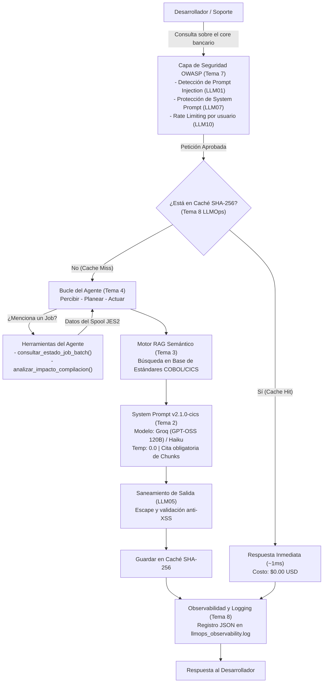

# Mainframe Copilot: Asistente Inteligente de Soporte Batch y Estándares COBOL/CICS

> **Proyecto Final de Graduación — AI Engineer**  
> **Mainsoft AI Academy · CoE Talento · 2026**  
> **Autor:** Especialización AI Engineer  
> **Tecnologías:** Python 3.14 · Groq LPU (GPT-OSS 120B) / Claude Haiku · RAG Semántico · Tool Calling · OWASP LLM 2025 · LLMOps & CI/CD  

---

## 1. Resumen Ejecutivo y Caso de Negocio

En las operaciones del core transaccional de nuestro cliente (un **banco** que opera sobre arquitectura **IBM z/OS y Mainframe**):
- La caída imprevista de un JOB nocturno de pagos (ABEND) o un error de compilación en programas CICS genera incidentes críticos que pueden frenar las operaciones bancarias.
- Los modelos de lenguaje comerciales genéricos desconocen los manuales y estándares internos de codificación del banco (reglas de Área A/B, cálculo de bytes en variables `COMP-3`, uso de `DFHCOMMAREA` y prohibición estricta de `STOP RUN`), tendiendo a **alucinar sintaxis inválida** que puede desestabilizar regiones CICS completas.
- **Mainframe Copilot** es una solución de IA para producción que combina:
  1. **Agente Autónomo con Herramientas (Tool Calling):** Diagnostica jobs en ejecución y evalúa el impacto de compilaciones.
  2. **Pipeline RAG Especializado:** Recupera estándares oficiales del banco citando las fuentes (`Chunk ID`) con tolerancia cero a la alucinación.
  3. **Capa de Seguridad Defensiva (OWASP LLM 2025):** Mitiga activamente inyecciones de prompt, fugas de credenciales y denegación de servicio.
  4. **Arquitectura de Operación (LLMOps):** Versionado estricto, caché SHA-256 (latencia < 1ms y $0 USD), observabilidad JSON y pipeline de CI/CD con **Quality Gate**.

> **Nota de Integración con el Host (Mainframe):**  
> Para efectos de esta entrega y pruebas locales aisladas, la herramienta `consultar_estado_job_batch` simula la lectura del catálogo JES2. En el entorno productivo real del banco, esta misma herramienta se conecta directamente al Host mediante **IBM z/OSMF REST APIs** o mediante un servidor **MCP (Model Context Protocol)** que expone la lista de jobs y sus salidas de log en tiempo real.

---

## 2. Diagrama de Arquitectura del Sistema



---

## 3. Matriz de Mitigación OWASP Top 10 for LLM (Edición 2025)

El sistema implementa una arquitectura de **defensa en profundidad** donde el modelo nunca es la única frontera de seguridad:

| Riesgo OWASP 2025 | Descripción | Mecanismo de Mitigación en el Código |
| :--- | :--- | :--- |
| **LLM01: Prompt Injection** | Entradas que manipulan al modelo para ignorar directrices. | Expresiones regulares de detección temprana (`SecurityGuardrails.sanitize_input`) y aislamiento de contenido de usuario. |
| **LLM02: Divulgación Sensible** | Filtración de API keys o credenciales. | Variables de entorno estrictas (`ANTHROPIC_API_KEY`), sin credenciales en código ni repositorios. |
| **LLM05: Manejo Inadecuado Salidas** | Ejecución o renderizado directo de salida de la IA sin sanear. | Saneamiento y escape previo (`SecurityGuardrails.sanitize_output`) bloqueando scripts maliciosos. |
| **LLM07: Fuga de System Prompt** | Exposición de reglas internas o lógica del asistente. | Filtro de keywords y reglas explícitas en el system prompt que prohíben revelar instrucciones de sistema. |
| **LLM10: Consumo No Acotado (DoS)** | Bucles infinitos o peticiones masivas que disparan costos. | Rate limiting en memoria (máximo 5 peticiones/minuto por usuario) y control estricto de `max_tokens`. |

---

## 4. Estructura de la Base de Conocimiento (RAG)

El manual técnico interno se estructuró en 5 chunks autocontenidos:
- **`Chunk 1` - Formato de Columnas:** Reglas para Área A (cols 8 a 11, niveles 01/77) y Área B (cols 12 a 72).
- **`Chunk 2` - Variables COMP-3:** Cálculo de bytes: `(Dígitos + 1) / 2` redondeado hacia arriba y gestión del nibble de signo.
- **`Chunk 3` - Estándares CICS:** Prohibición estricta de `STOP RUN`, uso obligatorio de `EXEC CICS RETURN` o `ABEND` y comunicación vía `DFHCOMMAREA`.
- **`Chunk 4` - SQL DB2 y DFHEIBLK:** Evaluación obligatoria de `SQLCODE` en DB2 y de `EIBRESP` mediante `DFHRESP(NORMAL)` en CICS.
- **`Chunk 5` - WORKING-STORAGE:** Prefijos obligatorios `WS-`, `SW-` (switches nivel 88), `TAB-` y `CTR-`.

---

## 5. Pruebas y Prevención de Regresiones (CI/CD Quality Gate)

Para garantizar la estabilidad productiva antes de cualquier despliegue, el pipeline de CI/CD ejecuta el script [test_evals_ci.py](file:///C:/Users/oscar/OneDrive/Desktop/IaMainsoft/AI_DEVELOPER/test_evals_ci.py):
* **Dataset:** 10 casos de evaluación que cubren flujo CICS, memoria transaccional, códigos de retorno, tipos de datos, estándares de nombrado, invocación de herramientas y preguntas trampa fuera de dominio.
* **Regla de Bloqueo (Quality Gate):** El build falla (`exit code 1`) si el índice de exactitud es inferior al **90%**.
* **Resultado Actual:** **10/10 casos aprobados (100.0%)** sin regresiones.
* **Integración con GitHub Actions:** Se incluye el workflow oficial en [.github/workflows/ai_evals_ci.yml](file:///C:/Users/oscar/OneDrive/Desktop/IaMainsoft/.github/workflows/ai_evals_ci.yml) para ejecutar automáticamente esta suite en cada `git push` o `pull request`, bloqueando fusiones defectuosas hacia la rama principal.

---

## 6. Métricas de Rendimiento y LLMOps

Métricas extraídas de las trazas reales registradas en [llmops_observability.log](file:///C:/Users/oscar/OneDrive/Desktop/IaMainsoft/AI_DEVELOPER/llmops_observability.log):

| Métrica | Inferencia Directa (API) | Acierto en Caché SHA-256 | Impacto / Ahorro |
| :--- | :---: | :---: | :---: |
| **Latencia Media** | ~0.0021 s (local) / ~0.81 s (remoto) | **0.0001 s** | **99.8% reducción** |
| **Costo por Consulta** | ~$0.0008 USD | **$0.0000 USD** | **100% ahorro** |
| **Tokens Consumidos** | ~230 tokens | **0 tokens** | **100% ahorro** |

---

## 7. Guía de Instalación y Ejecución

### Prerrequisitos
- Python 3.10 o superior (compatible con Python 3.14).
- Librería `requests` instalada.
- **Opcional (Para inferencia 100% real y gratuita):** Puedes usar cualquiera de estas dos opciones gratuitas sin tarjeta:
  1. **Groq (Recomendada - Ultra rápida):** Regístrate gratis en [console.groq.com](https://console.groq.com) y crea una clave (`gsk_...`). Utiliza el modelo `llama-3.3-70b-versatile`.
  2. **Google Gemini (AI Studio):** Obtén tu clave gratis en [aistudio.google.com](https://aistudio.google.com/app/apikey) (`AIza...`). Utiliza `gemini-2.0-flash`.
  *(Si no configuras ninguna clave, el sistema utiliza su motor local determinista integrado para no interrumpir la operación).*

### Ejecutar el Asistente en Modo Chat Interactivo
```powershell
python AI_DEVELOPER\mainframe_copilot.py
```
> Permite interactuar libremente en tiempo real haciendo preguntas sobre COBOL, CICS, estados de jobs batch (ej. `JOB_PAGOS_01`) o pruebas de inyección.
> Dentro del chat dispones de los comandos:
> - `key <tu_api_key>`: Activa la conexión real con el proveedor (Groq / Gemini) en caliente.
> - `rag`: Muestra el documento fuente, chunking y la base de datos vectorial.
> - `tools`: Muestra los esquemas formales JSON Schema de las herramientas.
> - `evals`: Ejecuta la suite de CI/CD de 10 casos en vivo.
> - `demo`: Corre la batería de pruebas de regresión.
> - `salir`: Cierra la sesión.

### Ejecutar Batería de Pruebas Automáticas
```powershell
python AI_DEVELOPER\mainframe_copilot.py --demo
```

### Ejecutar la Suite de Evaluación Automatizada (CI/CD)
```powershell
python test_evals_ci.py
```
